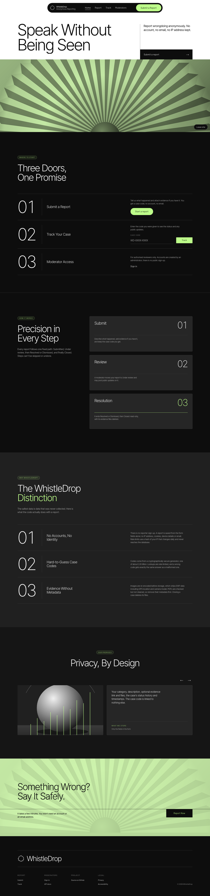
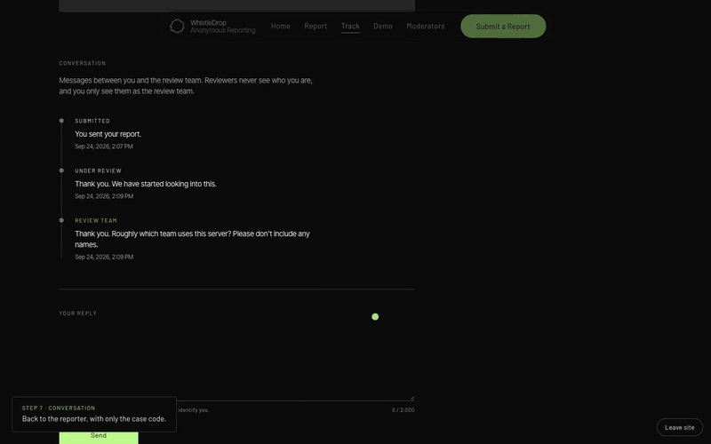
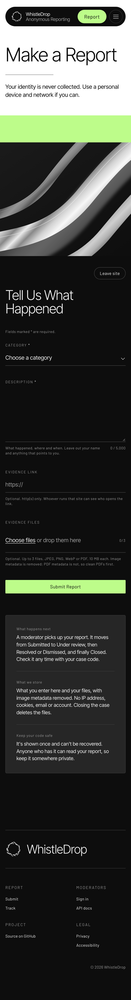
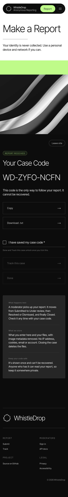
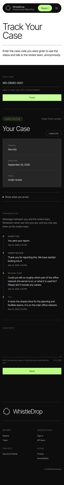
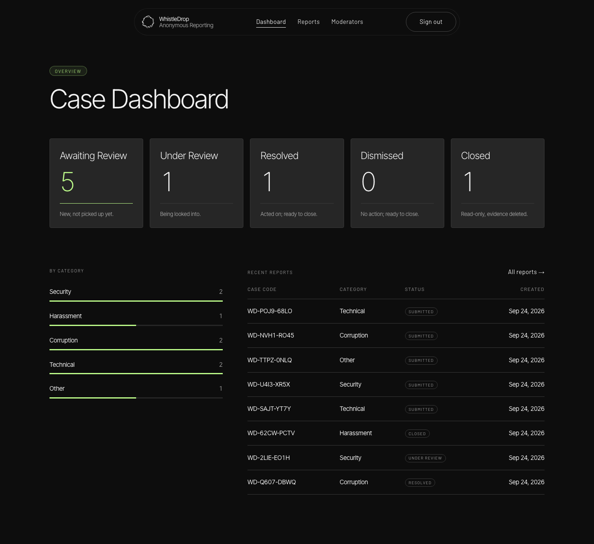
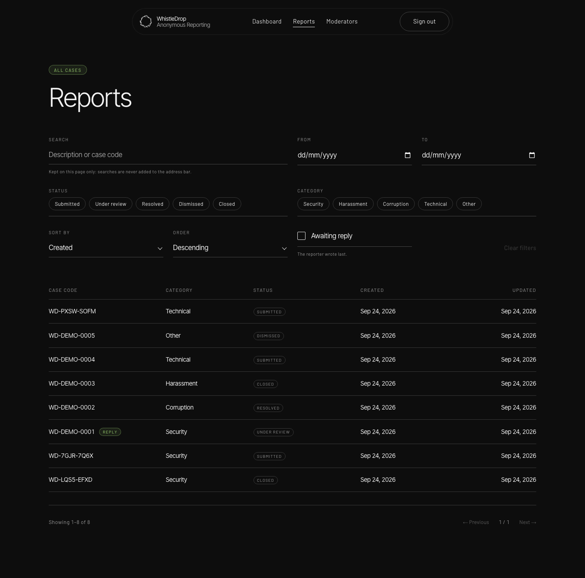
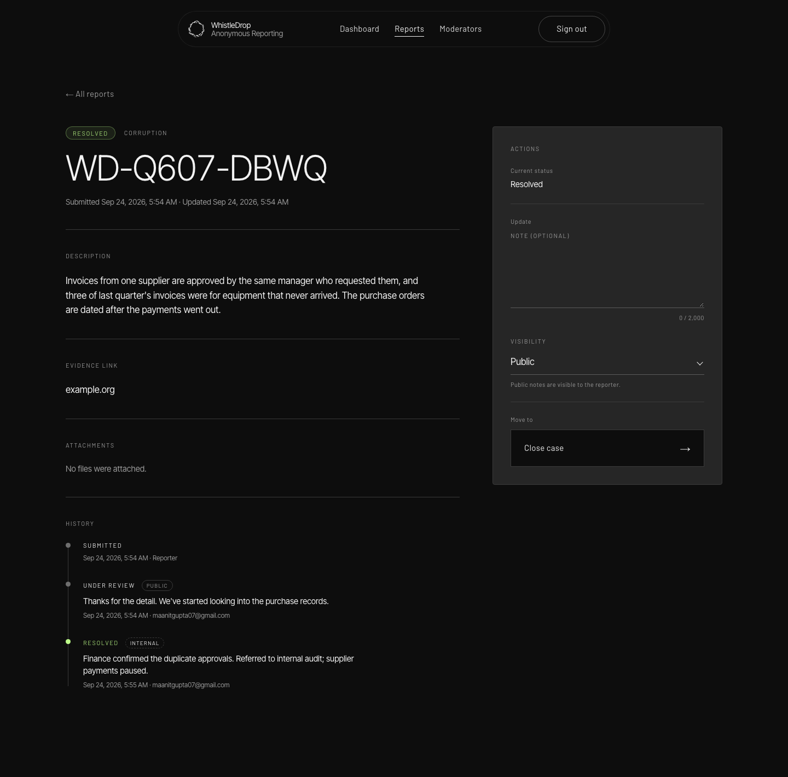
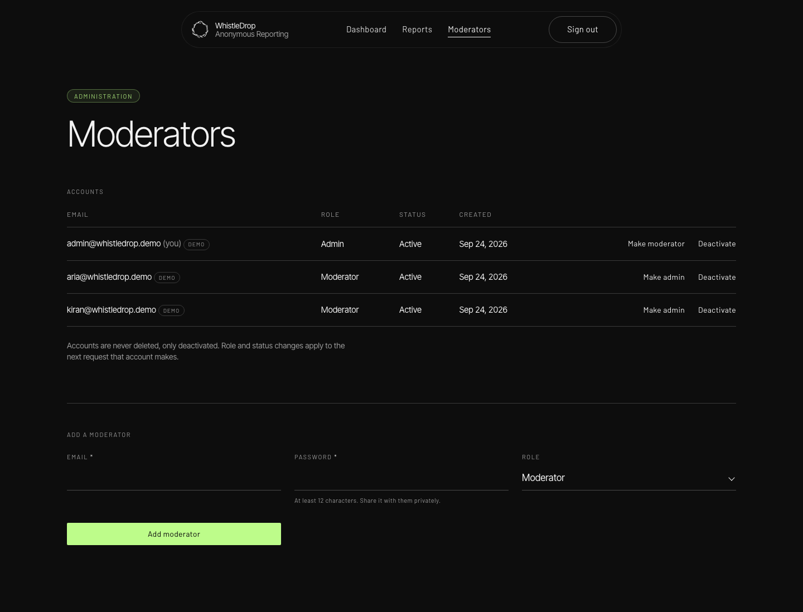

<div align="center">

# WhistleDrop

**Speak without being seen.**

An anonymous reporting service. Submit a report without an account, get a case code only you hold, and follow your case while moderators review it.


[**Live app**](<https://whistle-drop.vercel.app/>) · [**API docs**](<https://whistle-drop.vercel.app/api-docs>) · [**Full documentation**](whistledrop/README.md) · [**Demo sign-ins**](whistledrop/DUMMY_SIGN_INS.txt)



</div>

## Demo

<a href="<LIVE_URL>/#demo"></a>

*[Watch the full walkthrough on the live site](<LIVE_URL>/#demo)* (2:18, no sound): Submit · Track · Review · Conversation · Close · Admin. To try it yourself, the demo moderator accounts are in [`DUMMY_SIGN_INS.txt`](whistledrop/DUMMY_SIGN_INS.txt).

## What it is

WhistleDrop is my submission for the **GDG on Campus SRM** Technical Domain brief, *"WhistleDrop — Speak Without Being Seen"*.

- **Reporters** choose a category and describe the issue. They can add a link and up to three evidence files. In return they get a case code such as `WD-7K2P-Q9XM`, which they use to track the case and talk to the review team anonymously. There's no account and no email, and nothing links the code back to them.
- **Moderators** sign in to a dashboard where they can search and filter reports and download evidence through links that expire after 60 seconds. They move each case through `SUBMITTED → UNDER_REVIEW → RESOLVED | DISMISSED → CLOSED` reply to the reporter (who only ever sees "the review team"), and keep staff-only internal notes. Closing a case makes it read-only permanently and deletes its evidence.

## Highlights

| | |
| --- | --- |
| 🕶️ **No identity stored** | No IPs, cookies, user agents or accounts for reporters. Rate limiting uses an HMAC of the IP that rotates daily and is stored only in Redis. |
| 🧼 **Metadata stripped** | Every image is re-encoded, which removes EXIF data such as GPS location and device model. Uploads are checked by their magic bytes, not the name the client gives them. |
| 🔒 **Locked-down headers** | A nonce-based CSP, `no-referrer`, `no-store` on the API, no analytics, and fonts served from our own origin. |
| 🚪 **Safe exits** | A "Leave site" button on every reporter page, and a warning before any link that leaves WhistleDrop. |
| 💬 **Anonymous conversation** | Reporters and moderators can message each other through the case code. Messages store only their text; moderators appear as "Review team"; internal notes are a separate staff-only channel. |
| 🛡️ **Accountable staff** | Every status change records which moderator made it. Roles are re-checked against the database on every request, and the last admin can't be removed. |
| 📖 **Documented API** | An OpenAPI 3.1 spec generated from the same Zod schemas that validate requests, with Swagger UI at `/api-docs`. |
| ✅ **Tested** | Unit tests, integration tests against a real Postgres, and end-to-end CSP tests against the production build. |

## Screenshots

<table>
  <tr>
    <th>Make a report</th>
    <th>Case code</th>
    <th>Track a case</th>
  </tr>
  <tr>
    <td></td>
    <td></td>
    <td></td>
  </tr>
</table>

<details>
<summary><b>Moderator area</b> (click to expand)</summary>

<br>

**Dashboard**



**Reports list with search and filters**



**Report detail**



**Moderator management (admins)**



</details>

All desktop and mobile screenshots are in [`whistledrop/docs/screenshots/`](whistledrop/docs/screenshots/).

## Quick start

```bash
git clone https://github.com/maanit-gupta/WhistleDrop.git
cd WhistleDrop/whistledrop
npm install
cp .env.example .env.local   # fill in Supabase, secrets and (optionally) Upstash
npm run db:deploy && npm run storage:setup && npm run db:seed
npm run dev                  # http://localhost:3000, API docs at /api-docs
```

To run the tests:

```bash
npm test                                         # unit tests
npm run test:db:up && npm run test:integration   # integration tests (Docker)
```

The full setup guide, including where to find each Supabase key and every environment variable, is in the [full documentation](whistledrop/README.md#local-setup).

## API endpoints

All bodies are JSON and every API response has `Cache-Control: no-store`. Moderator and admin routes need `Authorization: Bearer <token>` from `POST /api/mod/login`. Full schemas are at `/api-docs` (Swagger UI) and `/api/openapi` (OpenAPI 3.1).

| Method | Route | Auth | Purpose |
| --- | --- | --- | --- |
| `POST` | `/api/uploads/sign` | None (rate limited) | Get a signed upload URL and a 30-minute upload token for one evidence file |
| `POST` | `/api/reports` | None (rate limited) | Submit an anonymous report; returns its case code |
| `POST` | `/api/reports/lookup` | None (rate limited) | Track a case by its code (preferred: the code stays out of URLs and logs) |
| `GET` | `/api/reports/:caseCode` | None (rate limited) | Same as the lookup above, kept for compatibility |
| `POST` | `/api/reports/messages` | None (rate limited) | Reporter sends a message to the review team |
| `POST` | `/api/mod/login` | None (rate limited) | Moderator sign-in; returns a 12-hour bearer token |
| `GET` | `/api/mod/reports` | Moderator | List, search, filter, sort and paginate reports |
| `GET` | `/api/mod/reports/:id` | Moderator | Full report with history, conversation, internal notes and attachments |
| `PATCH` | `/api/mod/reports/:id/status` | Moderator | Move a case through the workflow, with an optional PUBLIC or INTERNAL note |
| `POST` | `/api/mod/reports/:id/messages` | Moderator | Reply to the reporter (shown as "Review team") |
| `POST` | `/api/mod/reports/:id/notes` | Moderator | Add a staff-only internal note |
| `GET` | `/api/mod/reports/:id/attachments/:attachmentId` | Moderator | Get a download link for evidence that expires after 60 seconds |
| `GET` | `/api/admin/moderators` | Admin | List moderator accounts |
| `POST` | `/api/admin/moderators` | Admin | Create a moderator or admin |
| `PATCH` | `/api/admin/moderators/:id` | Admin | Change a moderator's role or active status |
| `GET` | `/api/cron/cleanup` | `CRON_SECRET` | Daily job that deletes stale staged uploads and expired token records |
| `GET` | `/api/openapi`, `/api-docs` | None | OpenAPI document and Swagger UI |

Errors always have the shape `{ "error": { "code": "...", "message": "..." } }`. Field rules and every status code are in the [API reference](whistledrop/README.md#api-reference).

## How anonymity is maintained

- **Nothing identifying is stored.** Reports and reporter messages are built only from validated body fields. No IP address, user agent, cookie, session, fingerprint, email or account reaches the database, storage metadata or logs, and strict schemas reject any extra field. Tests check that request headers and the sender's IP never reach the database.
- **Case codes are random bearer secrets.** `WD-XXXX-XXXX` is built from 8 CSPRNG characters (about 1.8 × 10¹² possibilities) and has no link to the report id, the time or the content. The UI keeps it in memory only, and the Track page sends it in the request body so it never appears in a URL.
- **Rate limiting without identity.** The limiter key is an HMAC-SHA256 of the IP, keyed with a secret and the current UTC date. It changes every day, exists only as an expiring Redis key, and is never written to Postgres or logged.
- **Evidence is sanitized.** Images are re-encoded, which drops EXIF, GPS, XMP and IPTC data. File types are checked by magic bytes. Evidence is deleted when a case closes.
- **Moderators are anonymous to reporters too.** Replies show only as "Review team". The public view is built from an explicit allowlist of fields, and internal notes live in a separate table the public path never reads.
- **No third parties.** No analytics. Fonts, video and Swagger UI are self-hosted. There's a nonce-based CSP, `Referrer-Policy: no-referrer`, a warning before every outbound link, and a "Leave site" button that replaces the page in browser history.
- **Database lockdown.** Row-level security with no policies blocks Supabase's public Data API on every table.

The full details, including exactly which columns each table stores, are in [How anonymity is maintained](whistledrop/README.md#how-anonymity-is-maintained).

## Example requests and responses

Submit a report:

```bash
curl -s -X POST "$BASE/api/reports" -H 'content-type: application/json' \
  -d '{"category":"CORRUPTION","description":"The lab equipment budget was billed twice for the same order in March.","evidenceUrl":"https://example.org/invoice-scan"}'
```

```json
{ "caseCode": "WD-WR0A-5I3J" }
```

Track it as the reporter:

```bash
curl -s -X POST "$BASE/api/reports/lookup" -H 'content-type: application/json' -d '{"caseCode":"WD-WR0A-5I3J"}'
```

```json
{
  "category": "CORRUPTION",
  "description": "The lab equipment budget was billed twice for the same order in March.",
  "evidenceUrl": "https://example.org/invoice-scan",
  "status": "SUBMITTED",
  "createdAt": "2026-09-24T07:32:58.555Z",
  "statusUpdates": [],
  "conversation": []
}
```

Sign in as a moderator:

```bash
curl -s -X POST "$BASE/api/mod/login" -H 'content-type: application/json' \
  -d '{"email":"admin@example.org","password":"<password>"}'
```

```json
{ "token": "eyJhbGciOiJIUzI1NiJ9…", "tokenType": "Bearer", "expiresIn": 43200 }
```

A validation error:

```json
{ "error": { "code": "VALIDATION_ERROR", "message": "description: Too small: expected string to have >=20 characters" } }
```

The full case lifecycle (review, conversation, internal notes, closing) is in [Example requests](whistledrop/README.md#example-requests-a-full-case-lifecycle).

## Assumptions and design decisions

- **Assumptions.** Reporters may be on shared or monitored devices, so nothing is kept in the browser. Moderators are trusted staff, but their actions are audited and they still can't see who reported. The app runs behind Vercel's proxy, which sets `X-Forwarded-For`.
- **Accountable staff, unlinkable reporters.** Every status change, reply and note records the acting moderator. Accounts with history can only be deactivated, never deleted, and the database enforces this. Nothing about the reporter exists to record.
- **Status workflow.** `SUBMITTED → UNDER_REVIEW → RESOLVED | DISMISSED → CLOSED`. Invalid transitions return `409`. A closed case is permanently read-only (`423`), and its evidence is deleted.
- **Single-use upload tokens.** Tokens are stateless JWTs. Used token ids go into `ConsumedUploadToken`, which holds only a random id and a timestamp and is cleared after expiry. Submissions are all or nothing.
- **Rate limits.** 30 lookups per 15 minutes makes guessing codes hopeless. Submissions are limited to 10 per hour, upload signatures to 30 per hour and logins to 10 per 15 minutes.
- **CSP nonces** rather than hashes or `'unsafe-inline'`. The cost is that pages render on demand.
- **One source of truth for the API.** The OpenAPI spec is generated from the same Zod schemas that validate requests.

More detail is in [Design decisions and assumptions](whistledrop/README.md#design-decisions-and-assumptions) and [Security decisions](whistledrop/README.md#security-decisions).

## Documentation

The app lives in [`whistledrop/`](whistledrop/). Its [README](whistledrop/README.md) is the full submission document:

- [Architecture](whistledrop/README.md#architecture) and [status workflow](whistledrop/README.md#status-workflow)
- [The conversation model](whistledrop/README.md#the-conversation-model), [how anonymity is maintained](whistledrop/README.md#how-anonymity-is-maintained) and [security decisions](whistledrop/README.md#security-decisions)
- [Evidence upload flow](whistledrop/README.md#evidence-upload-flow)
- [API reference](whistledrop/README.md#api-reference) and [curl examples for a full case lifecycle](whistledrop/README.md#example-requests-a-full-case-lifecycle)
- [Deployment on Vercel](whistledrop/README.md#deployment-vercel) and the [protected demo accounts](whistledrop/README.md#demo-accounts) ([`DUMMY_SIGN_INS.txt`](whistledrop/DUMMY_SIGN_INS.txt))
- [Known limitations](whistledrop/README.md#known-limitations)

## Acknowledgements

Built for the **GDG on Campus SRM** recruitment 2026–27 (Technical Domain). The interface follows the **"Lime Ledger"** design language.
